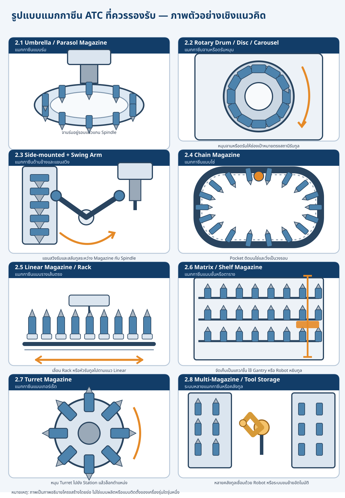
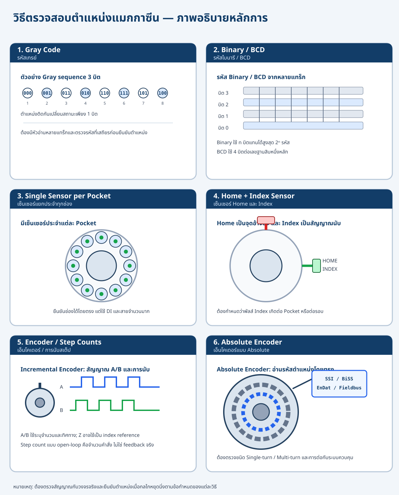
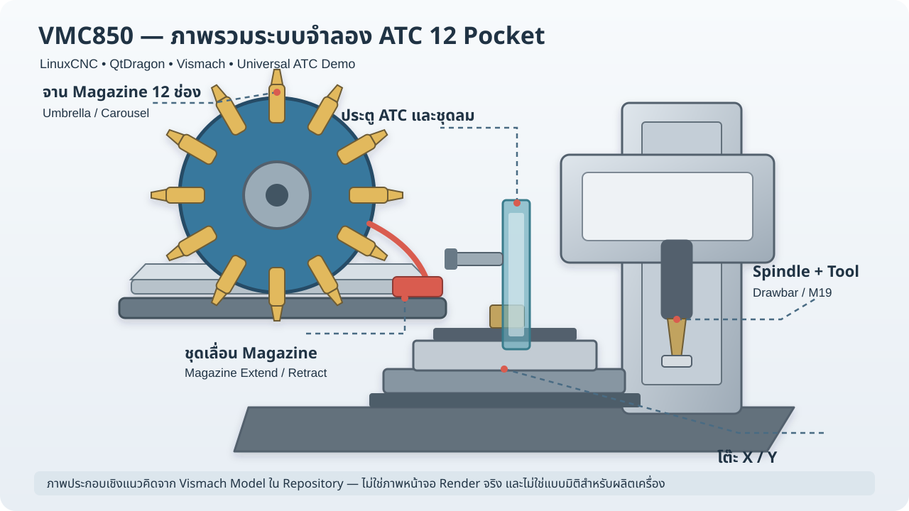

# LinuxCNC Universal ATC — Demo

**โครงการสาธิตระบบตั้งค่า Automatic Tool Changer (ATC) สำหรับ LinuxCNC**

สถานะโครงการ: **Public Demo — ทดลองด้วย Simulation เท่านั้น**  
รูปแบบ: **GUI Configurator + VMC850 Vismach Simulation**  
Repository นี้เป็นชุดสาธิตที่คัดแยกจากโครงการพัฒนาหลัก เพื่อให้ทดลองและตรวจสอบได้โดยไม่เปิดเผยเอกสาร Hardware ภายใน

> **ข้อควรทราบ:** นี่คือซอฟต์แวร์สาธิต ไม่ใช่ระบบควบคุม ATC สำหรับเครื่อง CNC จริง ห้ามต่อเข้ากับ Servo Drive, VFD, Solenoid Valve หรืออุปกรณ์ขับเคลื่อนจริง

## เป้าหมายของ Demo

แสดงแนวทางการตั้งค่า ATC แบบ Universal ผ่าน GUI โดยไม่ต้องให้ผู้ใช้เขียน HAL/INI เอง และทดลองลำดับการเปลี่ยนทูลผ่าน Simulation

ความสามารถที่รวมอยู่ในรุ่นนี้:

- Setup Wizard จำนวน 8 ขั้นตอน สำหรับเลือก Hardware, ATC Type, Magazine, Transfer, Feedback, M19 และ I/O
- Visual Configurator สำหรับคลิกตำแหน่ง Sensor/Output บนภาพเพื่อกำหนด I/O
- ATC Profile และ Configuration Schema แบบ JSON
- ตรวจสอบ Configuration และจัดสรร I/O อัตโนมัติ (Auto-map)
- สร้าง LinuxCNC Simulation Candidate แยกจากคอนฟิกต้นฉบับ
- QtVCP Panel และ ATC Monitor สำหรับดูสถานะ Input/Output และลำดับการทำงาน
- VMC850 Vismach Simulation พร้อม Magazine แบบ Carousel 12 Pocket
- จำลอง Spindle Orientation (M19), Drawbar, ประตู ATC และ Feedback ของ Sensor
- Automated Tests และ GitHub Actions

## ภาพรวมรูปแบบ ATC



ภาพนี้แสดงตัวอย่างโครงสร้าง Magazine และกลไกส่งทูลหลายรูปแบบ เพื่อให้เห็นว่า Magazine กับ Transfer Mechanism เป็นคนละส่วนของ Configuration

## ภาพรวมวิธีตรวจสอบตำแหน่ง Magazine



ระบบสามารถกำหนดวิธี Feedback ได้หลายแบบ เช่น Home/Index, Sensor ต่อ Pocket, Gray Code, Binary/BCD และ Encoder ทั้งนี้ต้องเลือกตามวงจรและกลไกของเครื่องจริง

## ภาพประกอบ VMC850 Simulation



แผนภาพนี้เป็นภาพประกอบเชิงแนวคิดจากองค์ประกอบใน Vismach Model ไม่ใช่ภาพหน้าจอ Render จริง ไม่ใช่แบบเครื่องผลิต และไม่ได้ยืนยันขนาดหรือระยะทางกลของ VMC850

## ภาพรวมการทำงาน

1. เลือก Hardware Capability Manifest ที่ใช้ในการจำลอง
2. เลือก ATC Profile และกำหนดรูปแบบ Magazine / Transfer
3. กำหนด Position Feedback และการจัดแนว Spindle (M19)
4. กำหนด Logical Signal ให้กับ Resource I/O
5. กด Validate เพื่อตรวจสอบ Configuration
6. สร้าง Candidate แยกสำหรับ LinuxCNC Simulation
7. เปิด QtDragon และทดลองดู Vismach / ATC Monitor

**ข้อจำกัดสำคัญ:** ATC Enable ยังปิดอยู่ และยังไม่มี Live Apply การกด Apply ใน Demo จะสร้างไฟล์ Candidate สำหรับทดสอบเท่านั้น ไม่ได้สั่ง M6/M19 จริง ไม่ได้ขับ Output จริง และไม่ได้ควบคุมการเคลื่อนที่ของเครื่องจริง

## เอกสารโครงการ

### ภาพรวมและกลไก ATC
- [ภาพรวมระบบ Universal ATC](docs/01-SYSTEM-OVERVIEW.md)
- [รูปแบบ ATC ที่รองรับ](docs/02-ATC-MECHANISMS.md)
- [วิธีตรวจสอบตำแหน่ง Magazine](docs/03-MAGAZINE-POSITIONING.md)
- [การจัดการ Tool และ Pocket](docs/04-TOOL-MANAGEMENT.md)
- [Spindle Orientation และ M19](docs/05-SPINDLE-ORIENTATION-M19.md)
- [ตำแหน่ง Z สำหรับ ATC — แนวทางที่วางแผนไว้](docs/Z-ATC-POSITIONS.md)

### Software และ Configurator
- [สถาปัตยกรรม Software](software/01-SOFTWARE-ARCHITECTURE.md)
- [ATC State Machine](software/02-ATC-STATE-MACHINE.md)
- [QtVCP ATC Configurator](software/03-QTVCP-CONFIGURATOR.md)
- [รูปแบบไฟล์ Configuration](software/04-CONFIGURATION-FORMAT.md)
- [ลำดับหน้าจอ GUI Configuration Wizard V1](software/05-GUI-CONFIGURATION-FLOW-V1.md)
- [Configuration Engine V1 — ขอบเขตและวิธีใช้งาน](docs/CONFIGURATION-ENGINE-V1.md)
- [รายการ ATC Profiles](profiles/README.md)

### Simulation และ Safety
- [VMC850 Simulation — QtDragon, Vismach และ ATC Monitor](docs/VMC850-SIMULATION.md)
- [Interlock, Fault และ Recovery](safety/01-INTERLOCK-RECOVERY.md)
- [ขอบเขตการเผยแพร่ Public Demo](docs/PUBLIC-DEMO-SCOPE.md)

## วิธีติดตั้งและทดลอง

### 1. ข้อกำหนด

- Linux ที่มี Desktop/X11 หรือใช้งานผ่าน VNC ได้
- LinuxCNC 2.9 รุ่น Simulation
- Python 3.9 หรือใหม่กว่า
- PyQt5, LinuxCNC Python/HAL modules, Vismach และ PyOpenGL
- `jsonschema` และ `pytest` สำหรับตรวจ Configuration และทดสอบ

ชื่อแพ็กเกจระบบอาจแตกต่างกันตาม LinuxCNC Distribution ควรใช้แพ็กเกจที่ตรงกับ Python ของระบบ LinuxCNC และสร้าง Virtual Environment โดยเปิด `--system-site-packages` เพื่อให้มองเห็นโมดูล LinuxCNC

### 2. Clone Repository

```bash
git clone https://github.com/TC227/linuxcnc-universal-atc-demo.git
cd linuxcnc-universal-atc-demo
```

### 3. สร้าง Python Environment

```bash
python3 -m venv --system-site-packages .venv
. .venv/bin/activate
python -m pip install -e ".[test]"
```

หาก PyQt5 ยังไม่มีใน Python ของระบบ ให้ติดตั้ง GUI extra เพิ่ม:

```bash
python -m pip install -e ".[test,gui]"
```

### 4. สร้าง VMC850 Simulation Candidate

```bash
python scripts/build_vmc850_sim.py
```

สคริปต์จะแจ้งตำแหน่งโฟลเดอร์ Candidate ที่สร้างขึ้น โดยใช้สำเนา LinuxCNC Simulation Configuration แยกต่างหาก ไม่เขียนทับคอนฟิกต้นฉบับ

เปิดไฟล์ `axis.ini` จาก path ที่สคริปต์รายงาน ตัวอย่าง:

```bash
linuxcnc ~/linuxcnc/configs/universal-atc-generated/vmc850-12-tool-sim-r001/axis.ini
```

หาก QtDragon Metric Sample อยู่คนละตำแหน่ง ให้ระบุ `--sample-dir` หรือใช้ `--base-config-dir` กับโฟลเดอร์ Simulation ที่แยกไว้และมี `axis.ini`

**การเปิด GUI/Vismach ต้องมี Linux Desktop หรือ DISPLAY ที่ใช้งานได้** ส่วน `QT_QPA_PLATFORM=offscreen` ใช้สำหรับ Automated Test เท่านั้น

### 5. ทดลอง Setup Wizard และตรวจ Configuration

```bash
atc-config validate \
  --config examples/configurations/vmc-12-rotary-dc-sim.json \
  --manifest examples/hardware-manifests/simulator-24di-16do.json
```

ตัวอย่าง Configuration เริ่มต้นยังไม่มี I/O Mapping จึงอาจแจ้ง Required Signal ที่ยังไม่ได้กำหนด ให้ใช้ Auto-map ใน Wizard หรือกำหนด Mapping ก่อนตรวจซ้ำ

### 6. รันทดสอบ

```bash
python -m pip install -e ".[test,gui]"
QT_QPA_PLATFORM=offscreen python -m pytest -q
```

หรือใช้สคริปต์:

```bash
bash scripts/test_ubuntu_local.sh
```

การทดสอบ GUI แบบ Offscreen ไม่ได้เปิด LinuxCNC จริงและไม่เข้าถึง Hardware

## โครงสร้าง Repository

| โฟลเดอร์ | หน้าที่ |
|---|---|
| `src/atc_configurator/` | Wizard, Validator, I/O Mapper, Candidate Generator และ Simulation Runtime |
| `qtvcp/` | QtVCP Panel Integration |
| `scripts/` | สคริปต์สร้าง VMC850 Simulation และเครื่องมือทดสอบ |
| `examples/` | ตัวอย่าง ATC Configuration และ Hardware Manifest สำหรับ Simulation |
| `profiles/` | รายการ ATC Profile |
| `schemas/` | JSON Schema สำหรับ Configuration, Manifest และ Validation |
| `docs/` | เอกสารระบบ กลไก ATC และ Simulation |
| `software/` | สถาปัตยกรรม Software และ GUI Workflow |
| `safety/` | ข้อกำหนด Interlock, Fault และ Recovery |
| `tests/` | Unit Test และ GUI Smoke Test |

## ขอบเขตและข้อจำกัดทางวิศวกรรม

- Hardware Manifest ที่รวมอยู่เป็น **Simulation Manifest** เท่านั้น ไม่ใช่ข้อมูลวงจรหรือ Pinout ของ Mesa Board จริง
- ATC Enable ถูกปิด และยังไม่ Implement Live Apply
- Candidate Generator สร้างสำเนา LinuxCNC Simulation Configuration และ Metadata
- HAL ที่สร้างขึ้นไม่มีการสั่ง Physical Output หรือ Motion ของเครื่องจริง
- ลำดับ Tool Change และ M19 ใน Runtime เป็นการจำลอง ไม่ได้ส่งคำสั่ง M6/M19 จริงจาก Interpreter
- VMC850 Vismach เป็นโมเดลเชิงสาธิต ไม่ใช่โมเดลเครื่องที่ยืนยันมิติจริง
- ยังไม่มี Collision Detection, Safety Certification หรือการรับรองการทำงานกับเครื่องจริง
- ห้ามใช้ Demo นี้ควบคุม Servo, VFD, Solenoid, Pneumatic Valve, Tool Changer หรืออุปกรณ์จริง

ก่อนทดลอง โปรดอ่าน [VMC850 Simulation](docs/VMC850-SIMULATION.md) และ [Interlock / Recovery](safety/01-INTERLOCK-RECOVERY.md)

## ความสัมพันธ์กับโครงการหลัก

Repository นี้เป็น Public Demo ที่คัดเลือกเฉพาะไฟล์สำหรับสาธิต แยกจาก Repository พัฒนาหลักซึ่งยังคงเป็น Private โดยไม่มี Git History, Branch ภายใน, PCB Schematic, Board Layout, Pin Map หรือ Hardware Resource Document ภายในติดมาด้วย

## License

ขณะนี้ยังไม่ได้เพิ่มไฟล์ License ให้ Repository นี้ การมองเห็น Source Code แบบ Public บน GitHub **ไม่ได้หมายความว่าได้รับสิทธิ์นำไปใช้ แก้ไข หรือแจกจ่ายต่อโดยอัตโนมัติ** โปรดรอการกำหนด License จากเจ้าของโครงการก่อนนำโค้ดไปใช้ต่อ
