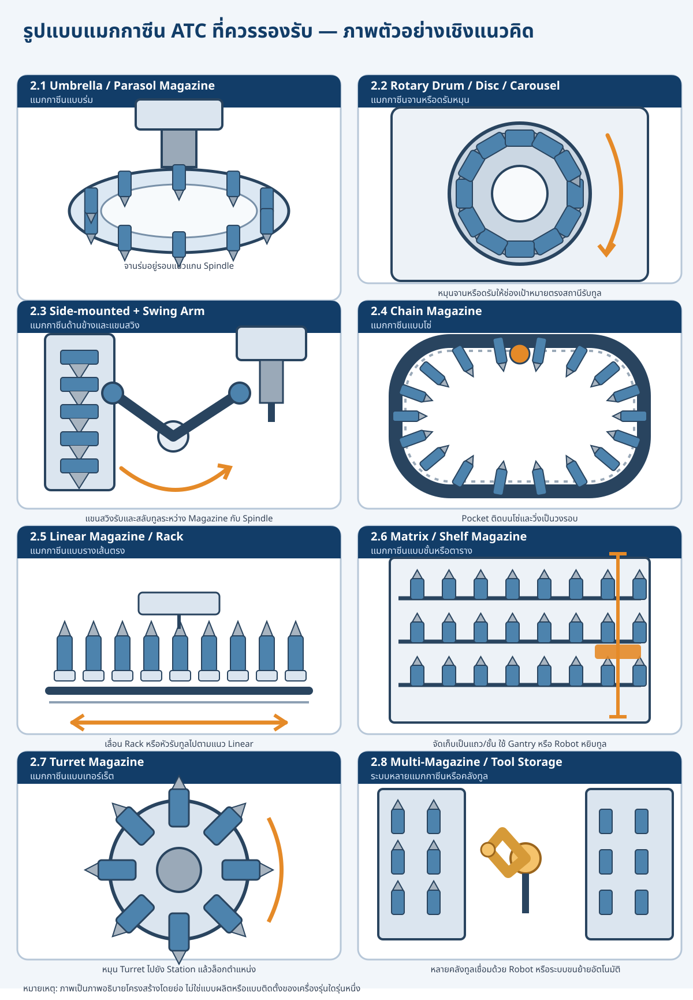

# 2. รูปแบบ ATC ที่ควรรองรับ

สถานะ: **DRAFT — เอกสารข้อกำหนดเบื้องต้น**

เอกสารนี้จัดประเภทระบบเปลี่ยนทูลอัตโนมัติ (Automatic Tool Changer: ATC) สำหรับเครื่อง CNC โดยแยก **รูปแบบการจัดเก็บทูล**, **วิธีขับเคลื่อนแมกกาซีน**, **กลไกส่งทูลเข้า/ออก Spindle** และ **วิธีตรวจสอบตำแหน่ง** ออกจากกัน เพราะเครื่องที่ใช้แมกกาซีนชนิดเดียวกันอาจใช้กลไกส่งทูลและเซ็นเซอร์คนละแบบได้

> ภาพประกอบเป็นภาพสื่อแนวคิดเพื่อช่วยจำแนกประเภท ไม่ใช่แบบเครื่องจริง แบบติดตั้ง หรือแบบผลิตชิ้นส่วน

## 2.1 Umbrella / Parasol Magazine — แมกกาซีนแบบร่ม

**โครงสร้าง:** ช่องใส่ทูลเรียงเป็นวงรอบจาน มักติดตั้งใต้ Spindle หรือด้านข้างเครื่อง จานอาจเลื่อนขึ้น-ลงหรือแกว่งเข้าหาตำแหน่งแลกทูล

**การหมุนและขับเคลื่อน**
- มอเตอร์เกียร์ DC พร้อมวงจรกลับทิศ CW/CCW
- Stepper หรือ Servo สำหรับควบคุมมุม
- กลไก Indexing แบบ Mechanical/Geneva ในเครื่องบางรุ่น
- หากหมุนได้สองทิศทาง ต้องตรวจว่าทางเดินสาย ลม และกลไกอนุญาตจริง

**เซ็นเซอร์ที่อาจใช้**
- `MAG_HOME` จุดอ้างอิงเริ่มต้น
- `MAG_IN_POSITION` ยืนยันตำแหน่งจาน
- `POT_UP` / `POT_DOWN` ตรวจตำแหน่ง Pot หรือชุดแมกกาซีน
- `MAG_EXCHANGE_POSITION` ตรวจว่าจานอยู่ในตำแหน่งแลกทูล
- `TOOL_PRESENT_SPINDLE` ตรวจว่ามีทูลใน Spindle
- `DRAWBAR_CLAMPED` / `DRAWBAR_UNCLAMPED` ตรวจสถานะจับทูล

**การหาช่องเป้าหมาย:** ในระบบ Fixed Pocket อาจกำหนด Tool Number ให้ตรงกับ Pocket Number ได้ แต่ต้องระบุ mapping ให้ชัด หากเป็น Random Pocket ต้องเก็บตาราง Tool-to-Pocket และปรับหลังแลกทูลสำเร็จเท่านั้น

**ลำดับการทำงานโดยทั่วไป**
1. รับคำสั่ง T และค้นหา Pocket เป้าหมาย
2. ตรวจว่าแกนเครื่องอยู่ตำแหน่งที่ปลอดภัย
3. หมุนจานไปยัง Pocket เป้าหมาย
4. ตรวจ `MAG_IN_POSITION` หรือรหัสตำแหน่ง
5. นำจาน/Pot เข้าตำแหน่งแลกทูล
6. จัดแนว Spindle ด้วย M19 หากเครื่องต้องการ
7. ทำการปลด/จับ Drawbar และแลกทูลตามกลไกจริง
8. ตรวจทูลและคืน Magazine สู่ตำแหน่งปลอดภัย

**ข้อควรระวัง:** Umbrella ไม่ได้หมายความว่าทุกเครื่องใช้ลำดับเดียวกัน บางรุ่นเคลื่อน Pot บางรุ่นเคลื่อน Spindle และบางรุ่นมีชุดยกหรือสวิงเพิ่มเติม

## 2.2 Rotary Drum / Disc / Carousel — แมกกาซีนแบบจานหรือดรัมหมุน

**โครงสร้าง:** ช่องเก็บทูลเรียงรอบจานหรือดรัม อาจติดตั้งแนวนอน แนวตั้ง หรือเอียง จำนวนช่องขึ้นอยู่กับขนาดและน้ำหนักทูล

**การหมุนและขับเคลื่อน**
- Servo/Stepper พร้อม Encoder
- มอเตอร์เกียร์พร้อม Home และ Sensor ยืนยันสถานี
- กลไก Indexer ที่หยุดตามตำแหน่งกลไก
- อาจใช้ Brake หรือกลไกล็อกเพื่อรับแรงขณะเปลี่ยนทูล

**เซ็นเซอร์ที่อาจใช้**
- `MAG_HOME` และ `MAG_IN_POSITION`
- Gray Code, Binary/BCD หรือ Encoder สำหรับอ่านหมายเลข Pocket
- `MAG_EXCHANGE_POSITION` ตรวจตำแหน่งสถานีรับทูล
- `DRIVE_READY` / `DRIVE_FAULT`
- Sensor ตรวจ Brake/Lock หากมี

**การคำนวณตำแหน่ง:** ถ้าระยะห่างเท่ากันทุกช่อง มุมต่อ Pocket เท่ากับ (360^circ/N) เมื่อ (N) คือจำนวน Pocket แต่ควรเก็บค่า Offset และทิศทางการหมุนที่สอบเทียบจากเครื่องจริง

**การส่งทูล:** อาจเป็น Direct Pickup โดย Spindle เคลื่อนเข้าหา Pocket หรือใช้แขนเปลี่ยนทูลแยกต่างหาก ดังนั้น Rotary Disc กับ Double Arm เป็นคนละมิติของ Configuration

## 2.3 Side-mounted Magazine + Swing Arm — แมกกาซีนด้านข้างพร้อมแขนสวิง

**โครงสร้าง:** แมกกาซีนติดตั้งด้านข้าง Spindle และมีแขนสำหรับรับทูลเก่า/ทูลใหม่ แขนอาจหมุน 180 องศา เลื่อนเข้า-ออก หรือทำงานร่วมกับ Gripper

**การหมุน Magazine:** อาจเป็น Disc หรือ Chain ขับด้วย Servo, Stepper หรือมอเตอร์เกียร์ และต้องหยุดที่ Exchange Station ก่อนแขนเข้าทำงาน

**เซ็นเซอร์ที่อาจใช้**
- Magazine: `MAG_HOME`, `MAG_IN_POSITION`, `MAG_EXCHANGE_POSITION`
- แขน: `ARM_HOME`, `ARM_0`, `ARM_180`, `ARM_EXTENDED`, `ARM_RETRACTED`
- Gripper: `GRIPPER_OPEN`, `GRIPPER_CLOSED`
- ทูล: `TOOL_PRESENT_ARM_A`, `TOOL_PRESENT_ARM_B`
- Spindle: `SPINDLE_STOPPED`, `SPINDLE_ORIENTED`, Drawbar Clamp/Unclamp

**การทำงานโดยทั่วไป**
1. เตรียม Pocket ของทูลใหม่ที่ Exchange Station
2. ยืนยัน Magazine หยุดและล็อกตำแหน่ง
3. หยุด Spindle และทำ M19
4. ยืนยันแกนเครื่องอยู่ตำแหน่งเปลี่ยนทูล
5. แขนเข้ารับทูลจาก Spindle และ Pocket
6. ปลด Drawbar และสลับตำแหน่งแขนตามลำดับของเครื่อง
7. ใส่ทูลใหม่และยืนยัน Clamp
8. ถอนแขนกลับ Home และยืนยัน Tool Presence

**ข้อควรระวัง:** ห้ามใช้ Timer แทนการยืนยันตำแหน่งแขนหรือ Gripper ในขั้นตอนที่อาจทำให้ทูลหล่นหรือชนกัน

## 2.4 Chain Magazine — แมกกาซีนแบบโซ่

**โครงสร้าง:** Pocket ติดตั้งบนโซ่ที่วิ่งเป็นวงปิด มีทั้งแบบโซ่แนวนอน แนวตั้ง และหลายชั้น เหมาะกับเครื่องที่ต้องการจำนวนทูลมากกว่าจานขนาดเล็ก

**การขับเคลื่อน**
- Servo พร้อม Encoder เป็นตัวเลือกที่ควบคุมตำแหน่งได้ดี
- Stepper ในระบบที่แรงบิดและความละเอียดเพียงพอ
- มอเตอร์เกียร์พร้อม Sensor/Code สำหรับระบบที่ไม่ต้องควบคุมมุมละเอียด
- ต้องพิจารณาแรงตึงโซ่ ระยะหย่อน Backlash และแรงเฉื่อย

**เซ็นเซอร์ที่อาจใช้**
- `MAG_HOME` จุดอ้างอิง
- Encoder A/B หรือ Absolute Encoder
- `MAG_EXCHANGE_POSITION` ยืนยัน Pocket ถึงสถานี
- `MAG_IN_POSITION` หรือ Pocket Code
- `DRIVE_READY`, `DRIVE_FAULT` และ Sensor ตรวจ Tension หากเครื่องมี
- Pocket Occupancy Sensor หากต้องติดตามทูลจริงในแต่ละช่อง

**การหาตำแหน่ง:** คำนวณจำนวน Count หรือระยะทางตาม Pitch ของ Pocket แต่ควรมีการยืนยันตำแหน่งจริงที่สถานีแลกทูล ไม่ควรเชื่อเฉพาะจำนวน Step ที่สั่งไป

## 2.5 Linear Magazine / Rack — แมกกาซีนแบบรางเส้นตรง

**โครงสร้าง:** Pocket เรียงเป็นแนวเส้นตรงหรือหลายราง ตัว Rack อาจเลื่อนผ่าน Spindle หรือให้ชุด Spindle/หัวรับทูลเคลื่อนเข้าหาช่อง

**การขับเคลื่อน**
- Linear Servo หรือ Stepper
- Ball Screw, Belt หรือ Rack-and-Pinion
- Pneumatic Shuttle สำหรับการเลื่อนระยะคงที่บางรูปแบบ
- หากใช้แกน CNC เป็นแกน Magazine ต้องจัดการ Coordinate, Limit และ Interlock แยกให้ชัด

**เซ็นเซอร์ที่อาจใช้**
- `RACK_HOME`
- `RACK_POSITIVE_LIMIT` / `RACK_NEGATIVE_LIMIT`
- Encoder หรือ Linear Scale
- `MAG_IN_POSITION`
- Pocket Occupancy Sensor
- `PICKUP_STATION_READY`

**การคำนวณเป้าหมาย:** สำหรับ Rack ที่มี Pitch คงที่ อาจใช้ (X_T=X_0+(P-1)	imes Pitch+Offset) โดย (P) คือหมายเลข Pocket แต่ต้องสอบเทียบ Pitch และ Offset และตรวจ Soft/Hard Limit ก่อนเคลื่อนที่

## 2.6 Matrix / Shelf Magazine — แมกกาซีนแบบชั้นหรือตาราง

**โครงสร้าง:** เก็บทูลในหลายแถว หลายคอลัมน์ หรือหลายระดับคล้ายคลังสินค้าอัตโนมัติ ต้องมีชุดหยิบทูลแบบ Gantry, Robot Arm หรือกลไกเลื่อนหลายแกน

**การขับเคลื่อน:** โดยทั่วไปเหมาะกับ Servo หลายแกนและ Controller/PLC ภายนอกมากกว่าการใช้ Digital I/O ของบอร์ดหลักควบคุมทุกการเคลื่อนที่

**เซ็นเซอร์ที่อาจใช้**
- Home/Limit/Position ของแกน X, Y, Z
- Encoder ของแต่ละแกน
- Gripper Open/Closed และ Tool Present
- Pocket Occupancy
- Door/Guard และ Drive Ready/Fault

**การคำนวณช่อง:** เก็บพิกัดของแต่ละ Pocket เป็นตาราง ไม่ควรคำนวณจากหมายเลขช่องอย่างเดียวหากระยะห่างหรือชั้นวางไม่เท่ากัน

**ข้อเสนอ:** ใช้ PLC/Robot Controller ทำ Motion และ Safety Interface ของคลังทูล แล้วให้ LinuxCNC ส่งคำขอ Tool ID/Source/Destination พร้อมรับ Ready/Busy/Complete/Fault

## 2.7 Turret Magazine — แมกกาซีนแบบเทอร์เร็ต

**โครงสร้าง:** สถานีเครื่องมือเรียงรอบหัว Turret มักพบในเครื่องกลึงและเครื่อง Mill-Turn แม้จะทำหน้าที่เลือก Tool Station คล้าย ATC แต่กลไก Clamp/Index ของ Turret แตกต่างจาก Magazine + Arm

**การขับเคลื่อน**
- Servo Indexing
- Hydraulic/Pneumatic Indexing
- Geneva หรือ Cam Indexer
- ระบบล็อกเชิงกลหลังหมุนถึงตำแหน่ง

**เซ็นเซอร์ที่อาจใช้**
- `TURRET_HOME`
- Station Code แบบ Binary/BCD/Gray หรือ Encoder
- `TURRET_CLAMPED` / `TURRET_UNCLAMPED`
- `TURRET_IN_POSITION`
- Drive Ready/Fault

**การเลือก Station:** คำนวณจาก Tool Station เป้าหมายและทิศทางที่อนุญาต ต้องยืนยันการ Clamp/Lock ก่อนอนุญาตให้ตัดเฉือน

**ข้อควรระวัง:** Turret ไม่ควรถูกบังคับให้ใช้ Sequence ของ Double Arm หรือ Umbrella เพราะมีขั้นตอนปลดล็อก หมุน และล็อกที่ต่างกัน

## 2.8 Multi-Magazine / Automatic Tool Storage — ระบบหลายแมกกาซีนหรือคลังทูลอัตโนมัติ

**โครงสร้าง:** มี Magazine มากกว่าหนึ่งชุด หรือเป็นคลังทูลส่วนกลางที่ใช้ Robot/Transfer Unit เคลื่อนย้ายทูลไปยังเครื่อง CNC

**องค์ประกอบที่อาจพบ**
- Magazine หลายชุดและแต่ละชุดมี ID
- Pocket/Storage Location แบบหลายระดับ
- Transfer Robot หรือ Gantry
- Gripper และสถานีรับ-ส่งทูล
- ระบบระบุตัวตน Tool ID เช่น RFID/Barcode (ถ้าติดตั้ง)
- PLC หรือ Warehouse Controller

**สัญญาณเชื่อมต่อที่แนะนำ**
- `REQUEST_TOOL` พร้อม Tool ID
- `SOURCE_MAGAZINE` / `SOURCE_POCKET`
- `DESTINATION_MAGAZINE` / `DESTINATION_POCKET`
- `READY`, `BUSY`, `COMPLETE`, `FAULT`
- `TOOL_ID_VALID` และข้อมูลตำแหน่งทูล

**ข้อเสนอด้านสถาปัตยกรรม:** ให้ External PLC/Robot Controller จัดการคลังทูลและการเคลื่อนที่หลายแกน ส่วน LinuxCNC ทำหน้าที่ประสานคำขอ M6 และรับผลลัพธ์ ต้องมีการบันทึกตำแหน่งทูลแบบ Transaction และกู้คืนสถานะหลังไฟดับได้

## 2.9 หลักการเลือก Profile

ไม่ควรสร้าง Profile แยกทุกความเป็นไปได้แบบตายตัว ให้เลือกจากคุณสมบัติ 5 ด้าน:

1. รูปแบบการจัดเก็บ (Magazine Geometry)
2. วิธีขับเคลื่อน/Indexing
3. กลไก Transfer
4. วิธี Position Feedback
5. รูปแบบ Tool Location: Fixed หรือ Random

ตัวอย่างเช่น `Chain + Servo + Double Arm + Incremental Encoder + Random Pocket` คือการประกอบคุณสมบัติจากหลายมิติ

## 2.10 ชื่อสัญญาณ Logical ที่ใช้ร่วมกัน

| สัญญาณ | หน้าที่ |
|---|---|
| `AIR_PRESSURE_OK` | แรงดันลมพร้อม |
| `MAG_HOME` | Magazine อยู่จุดอ้างอิง |
| `MAG_IN_POSITION` | Magazine ถึงตำแหน่งเป้าหมาย |
| `MAG_EXCHANGE_POSITION` | Magazine อยู่สถานีแลกทูล |
| `POT_UP` / `POT_DOWN` | ตำแหน่ง Pot |
| `ARM_HOME` / `ARM_0` / `ARM_180` | ตำแหน่งแขน |
| `ARM_EXTENDED` / `ARM_RETRACTED` | ระยะยืด/หดของแขน |
| `GRIPPER_OPEN` / `GRIPPER_CLOSED` | สถานะ Gripper |
| `TOOL_PRESENT_SPINDLE` | ตรวจพบ Tool ใน Spindle |
| `TOOL_PRESENT_ARM_A/B` | ตรวจพบ Tool ใน Gripper |
| `DRAWBAR_CLAMPED` / `DRAWBAR_UNCLAMPED` | สถานะ Drawbar |
| `DRIVE_READY` / `DRIVE_FAULT` | สถานะ Drive |

Logical Signal เหล่านี้เป็นชื่อกลาง ซอฟต์แวร์ต้องตรวจว่ากลไกที่เลือกจำเป็นต้องใช้สัญญาณใดบ้าง และ Hardware ต้องรองรับวงจรจริงก่อนให้เลือกใน GUI
