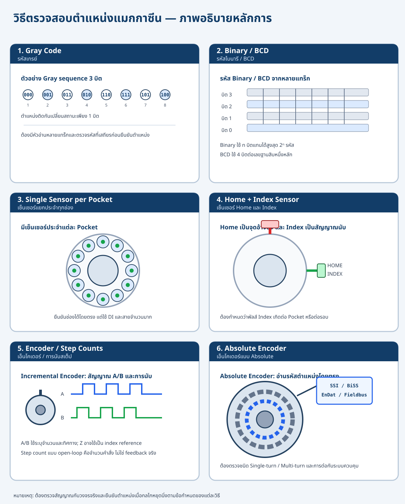

# 3. ระบบตรวจสอบตำแหน่ง Magazine

สถานะ: **DRAFT — เอกสารหลักการและข้อกำหนด**

การตรวจสอบตำแหน่ง Magazine มีหน้าที่ตอบให้ได้ว่า **ขณะนี้ Magazine อยู่ที่ช่องใด และอยู่ในตำแหน่งที่ปลอดภัยสำหรับแลกทูลหรือยัง** วิธีตรวจสอบแต่ละแบบมีจำนวน Input ความละเอียด ความทนต่อการคลาดเคลื่อน และต้นทุนต่างกัน

> ภาพเป็นแผนภาพหลักการ ไม่ใช่วงจรไฟฟ้าหรือ Pinout ของบอร์ดจริง การเลือก Interface ต้องตรวจแรงดัน สัญญาณ และทรัพยากร FPGA/HostMot2 ก่อนเสมอ

## 3.1 Gray Code — รหัสเกรย์

**หลักการ:** ใช้ Sensor หลายแทร็กอ่านรหัสตำแหน่ง โดยออกแบบให้ตำแหน่งที่อยู่ติดกันเปลี่ยนสถานะเพียง 1 บิต ช่วยลดโอกาสอ่านรหัสผสมในช่วงที่จานกำลังเคลื่อนผ่านขอบตำแหน่ง

ตัวอย่างลำดับ Gray Code 3 บิต:

| Pocket | รหัส |
|---:|:---:|
| 1 | 000 |
| 2 | 001 |
| 3 | 011 |
| 4 | 010 |
| 5 | 110 |
| 6 | 111 |
| 7 | 101 |
| 8 | 100 |

**จำนวน Input:** ถ้ามี (N) ตำแหน่ง ต้องใช้รหัสอย่างน้อย (n=lceillog_2 N
ceil) บิต โดยต้องกันรหัสที่ไม่ใช้หรือกำหนดเป็น Invalid ตามการออกแบบ

**ข้อดี**
- อ่านหมายเลข Pocket ได้โดยตรง
- ลดความกำกวมระหว่างการเปลี่ยนตำแหน่งเมื่อเทียบกับ Binary ปกติ
- ใช้ Input น้อยกว่าการติด Sensor แยกทุก Pocket เมื่อจำนวนช่องมาก

**ข้อจำกัด**
- ต้องมีแทร็ก/แผ่นรหัสและ Sensor หลายช่อง
- ต้องจัดแนวหัวอ่านและตำแหน่งรหัสให้แม่นยำ
- ต้องกรองสัญญาณและอ่านเมื่อรหัสเสถียร
- ต้องตรวจ Invalid Code และสถานะ Sensor ขัดแย้ง

**เหมาะกับ:** Rotary Disc, Drum หรือ Turret ที่มีหลายตำแหน่งและต้องการอ่านหมายเลขช่องจากรหัส

## 3.2 Binary / BCD — รหัสไบนารีและ BCD

**หลักการ Binary:** ใช้บิตหลายเส้นแทนหมายเลข Pocket โดยตรง เช่น 4 บิตแทนได้ 16 รหัส (0–15) จำนวนเส้นขั้นต่ำคือ (lceillog_2 N
ceil)

**หลักการ BCD:** ใช้ 4 บิตแทนเลขฐานสิบหนึ่งหลัก เช่น 24 ช่องอาจใช้ 2 หลัก BCD รวม 8 บิต ทั้งนี้ขึ้นอยู่กับการกำหนดรหัสและช่วงตำแหน่ง

**ข้อดี**
- เข้าใจง่ายและถอดรหัสด้วย PLC/HAL ได้ไม่ซับซ้อน
- เหมาะกับระบบที่มี Code Disc หรือ Sensor หลายแทร็กอยู่แล้ว
- ใช้ Input น้อยกว่าการติด Sensor แยกทุกช่อง

**ข้อจำกัด**
- Binary ปกติอาจเปลี่ยนหลายบิตพร้อมกัน เช่น 0111 ไป 1000 ทำให้อ่านค่าชั่วขณะผิดได้ระหว่างเคลื่อนที่
- ต้องอ่านหลังหยุดนิ่ง หรือใช้ Latch/Strobe ที่ออกแบบมารองรับ
- BCD ใช้ 4 บิตต่อเลขฐานสิบหนึ่งหลัก และมีรหัสที่ไม่ถูกต้องซึ่งต้องตรวจจับ

**เหมาะกับ:** Magazine ที่มีแผ่นรหัสตำแหน่งจากโรงงาน หรือระบบที่ PLC ส่งรหัสตำแหน่งให้ Controller

## 3.3 Single Sensor per Pocket — เซ็นเซอร์แยกประจำทุกช่อง

**หลักการ:** ติด Proximity Sensor, Limit Switch หรือ Sensor ชนิดอื่นไว้ที่แต่ละ Pocket เมื่อช่องใดอยู่ตรงสถานีตรวจสอบ Sensor ของช่องนั้นจะทำงาน

**จำนวน Input:** โดยทั่วไปต้องใช้ (N) Input หากอ่านทุก Pocket โดยตรง หรือใช้วงจร Multiplexer/Remote I/O เพื่อลดจำนวนสายและ Input ที่ Controller

**ข้อดี**
- ทราบช่องที่อยู่ตรงสถานีได้โดยตรง
- ตรวจสอบตำแหน่งจริงได้ ไม่ต้องอาศัยการนับพัลส์อย่างเดียว
- เหมาะกับ Magazine ที่จำนวนช่องไม่มากและเดินสายถึงแต่ละตำแหน่งได้

**ข้อจำกัด**
- ใช้ Input และสายไฟมากตามจำนวน Pocket
- ต้องติดตั้งและปรับตำแหน่ง Sensor ทุกช่อง
- ต้องออกแบบให้ไม่เกิดการอ่านสองช่องพร้อมกันโดยไม่ตั้งใจ
- ต้องตรวจ Sensor เสีย สายขาด และสัญญาณค้าง

**เหมาะกับ:** Umbrella หรือ Rotary Magazine จำนวนช่องน้อยถึงปานกลาง และระบบที่ต้องการยืนยัน Pocket แบบตรงไปตรงมา

## 3.4 Home + Index Sensor — เซ็นเซอร์ Home และ Index

**หลักการ:** ใช้ Home Sensor เป็นจุดอ้างอิง และใช้ Index Pulse จาก Encoder หรือ Sensor ตรวจ Marker เพื่ออ้างอิง/นับตำแหน่ง

ต้องแยกการออกแบบ 2 แบบให้ชัด:
- **Home + Encoder Index Z:** Home ใช้กำหนดตำแหน่งเริ่มต้น ส่วน Z มักเป็นพัลส์อ้างอิงต่อรอบของ Encoder ไม่ได้แปลว่าจะมีหนึ่งพัลส์ต่อ Pocket
- **Home + Pocket Index Pulse:** มี Marker/Pulse ที่สัมพันธ์กับแต่ละ Pocket แล้วนับจำนวน Pulse จาก Home เพื่อหาช่องเป้าหมาย

**ข้อดี**
- ใช้ DI น้อยกว่าการติด Sensor ทุกช่อง
- โครงสร้างง่ายเมื่อ Magazine มีระยะ Pitch สม่ำเสมอ
- ใช้ร่วมกับ Encoder หรือ Stepper ได้

**ข้อจำกัด**
- หากพลาด Pulse หรือมีการลื่น/หลุดสเต็ป ตำแหน่งที่คำนวณอาจคลาดเคลื่อน
- ต้องมีวิธีค้นหา Home ใหม่หลังเปิดเครื่องหรือเมื่อ Reference สูญหาย
- ต้องกำหนดขอบเขตการค้นหา Home และ Timeout
- ต้องยืนยันว่า Index เป็นต่อรอบหรือต่อ Pocket

**เหมาะกับ:** Rotary/Chain Magazine ที่มีจุด Home ชัดเจนและมี Encoder/Index สำหรับติดตามการเคลื่อนที่

## 3.5 Encoder / Step Counts — เอ็นโคเดอร์และการนับสเต็ป

**Incremental Encoder:** อ่านสัญญาณ A/B เพื่อทราบจำนวน Count และทิศทาง อาจใช้ Z เป็น Index Reference

**Stepper Step Counts:** นับจำนวน Step ที่ Controller สั่งให้มอเตอร์เคลื่อนที่ แต่หากไม่มี Encoder หรือ Sensor ยืนยัน จะเป็นเพียงตำแหน่งที่คาดหมาย ไม่ใช่ Feedback ว่ากลไกเคลื่อนถึงจริง

**สูตรประมาณตำแหน่ง Pocket**

ถ้าระยะห่างเท่ากันทุกช่อง:

[
CountsPerPocket=rac{CountsPerRevolution	imes GearRatio}{N}
]

[
TargetCount=HomeCount+(P-1)	imes CountsPerPocket+Offset
]

ต้องระบุให้ชัดว่า Encoder นับกี่ Count ต่อรอบ (PPR/CPR และ x1/x2/x4) รวมทั้งอัตราทดเกียร์และทิศทาง

**การเลือกเส้นทางหมุนแบบวงกลม**

กำหนด (N) = จำนวน Pocket, (C) = Pocket ปัจจุบัน และ (T) = Pocket เป้าหมาย:

[
Forward=(T-C+N)mod N
]

[
Reverse=(C-T+N)mod N
]

เลือกค่าที่สั้นกว่าได้เฉพาะเมื่อ Magazine อนุญาตให้หมุนได้ทั้งสองทิศทาง ต้องกำหนดทิศทางกรณีระยะเท่ากันไว้ด้วย หากหมุนได้ทิศทางเดียวให้ใช้ระยะทางตามทิศทางนั้นเท่านั้น

**ข้อดี**
- กำหนดตำแหน่งเป้าหมายได้ละเอียด
- เหมาะกับ Servo/Stepper และ Magazine ที่มีจำนวน Pocket มาก
- ใช้ข้อมูลความเร็วและทิศทางช่วยตรวจความผิดปกติได้

**ข้อจำกัด**
- Encoder Incremental ต้องมี Reference ที่เชื่อถือได้
- Backlash, Slip, Gear Ratio และการติดตั้ง Encoder ส่งผลต่อความแม่นยำ
- Step Counts แบบ Open-loop ไม่สามารถตรวจพบการหลุดสเต็ปได้ด้วยตัวเอง
- ต้องมี In-position Window และ Timeout

**เหมาะกับ:** Rotary Disc, Chain Magazine, Linear Rack และกลไกที่ต้องควบคุมตำแหน่งด้วย Motion Drive

## 3.6 Absolute Encoder — เอ็นโคเดอร์แบบแอบโซลูต

**หลักการ:** Encoder ส่งค่าตำแหน่งจริงในรูปแบบรหัสดิจิทัล โดยไม่ต้องเริ่มนับจากศูนย์ใหม่ทุกครั้งเหมือน Incremental Encoder บางรุ่นสามารถจำตำแหน่งได้หลังปิดไฟ ขึ้นอยู่กับชนิดและโครงสร้าง Encoder

**ประเภทที่ต้องแยก**
- Single-turn: บอกมุมภายในหนึ่งรอบ
- Multi-turn: บอกทั้งมุมและจำนวนรอบ
- Interface อาจเป็น SSI, BiSS-C, EnDat หรือ Fieldbus เช่น EtherCAT ตามรุ่นอุปกรณ์

**ข้อดี**
- อ่านตำแหน่งได้ทันทีหลังเปิดเครื่องในระบบที่รองรับ
- ลดขั้นตอน Homing ในบางระบบ
- เหมาะกับ Magazine ที่ต้องการความพร้อมและความน่าเชื่อถือสูง

**ข้อจำกัด**
- ราคาสูงกว่า Encoder Incremental ทั่วไป
- ต้องมี Interface/Controller ที่อ่าน Protocol นั้นได้จริง
- ต้องตั้งค่า Zero Offset, Direction, Resolution และ Gear Ratio
- Single-turn ไม่สามารถระบุจำนวนรอบได้เอง
- หาก Encoder ไม่ได้ติดตั้งกับเพลาที่สะท้อนตำแหน่งกลไกจริง อาจอ่านค่าได้แต่ไม่ทราบว่ามีการลื่นหรือหลวมทางกลหรือไม่

**เหมาะกับ:** Chain, Rotary Magazine ขนาดใหญ่, Multi-axis Storage และระบบที่ต้องการอ่านตำแหน่งหลังเปิดเครื่องโดยลดการ Homing

## 3.7 ตารางเปรียบเทียบ

| วิธี | จำนวน Input โดยทั่วไป | จุดเด่น | ข้อจำกัดหลัก |
|---|---:|---|---|
| Gray Code | (lceillog_2N
ceil) | เปลี่ยน 1 บิตระหว่างตำแหน่งติดกัน | ต้องทำ Code Track และอ่านเมื่อเสถียร |
| Binary | (lceillog_2N
ceil) | ถอดรหัสง่าย | อาจเปลี่ยนหลายบิตพร้อมกัน |
| BCD | 4 บิตต่อเลขฐานสิบหนึ่งหลัก | แสดงเลขฐานสิบโดยตรง | ใช้บิตมากกว่า Binary |
| Sensor per Pocket | ประมาณ N | ยืนยันช่องโดยตรง | สายและ DI มาก |
| Home + Index | โดยทั่วไป 2 หรือมากกว่าตามแบบ | ใช้ DI น้อย | ต้องนับ Pulse และรักษา Reference |
| Incremental Encoder | A/B และ Z ตามต้องการ | ได้ Count และทิศทาง | ต้อง Homing และจัดการ Count สูญหาย |
| Absolute Encoder | ตาม Protocol/Interface | อ่านตำแหน่ง Absolute | Interface และต้นทุนสูงกว่า |

จำนวน Input เป็นการประเมินหลักการเท่านั้น ไม่รวม Enable, Strobe, Alarm, Safety หรือสัญญาณตรวจยืนยันเพิ่มเติม

## 3.8 ข้อกำหนดการยืนยันตำแหน่ง

ไม่ว่าวิธีใด ATC Manager ต้องไม่ถือว่าถึงตำแหน่งเพียงเพราะคำสั่งหมุนจบลง ควรตรวจเงื่อนไขตามที่ Profile กำหนด เช่น:
- ค่า Code ถูกต้องและเสถียร
- Encoder อยู่ใน In-position Window
- Sensor ที่สถานีแลกทูลยืนยันตำแหน่ง
- Drive ไม่มี Alarm และพร้อมทำงาน
- Brake/Lock ทำงานแล้ว หากกลไกต้องใช้

## 3.9 การกู้คืนและสอบเทียบ

หลังเปิดเครื่องใหม่ ไฟดับ หรือ Encoder Reference สูญหาย ให้สถานะตำแหน่งเป็น UNKNOWN จนกว่าจะตรวจสอบใหม่ ห้ามใช้ตำแหน่งคำสั่งครั้งล่าสุดเป็นหลักฐานว่ากลไกยังอยู่ที่เดิม

หน้าจอ QtVCP ควรมีขั้นตอนสอบเทียบ:
1. Jog ไปยังจุด Home ด้วยโหมดบำรุงรักษาที่ปลอดภัย
2. กำหนด Home Offset และทิศทาง
3. Teach ตำแหน่ง Pocket แรก
4. ตั้ง Pitch หรือบันทึกตำแหน่งทุก Pocket
5. ตั้ง Tolerance และ Final Approach
6. สั่งตรวจทุก Pocket และบันทึกผล
7. บันทึก Calibration พร้อม Board/Drive/Profile Version

## 3.10 คำแนะนำการเลือกวิธี

- Magazine ขนาดเล็กและต้องการความง่าย: Home + Index หรือ Sensor per Pocket
- Rotary Disc ที่มีหลายช่อง: Gray Code, Binary/BCD หรือ Encoder
- Chain ที่ต้องการควบคุมแม่นยำ: Servo + Incremental/Absolute Encoder พร้อม Sensor ยืนยัน Exchange Position
- Linear Rack: Linear Encoder/Servo Feedback และ Limit/Home
- Matrix/Shelf: Absolute/Incremental Feedback ของแต่ละแกนผ่าน Motion Controller หรือ PLC
- Turret: Station Code หรือ Encoder พร้อม Clamp/Lock Confirmation

การเลือกสุดท้ายต้องอิงวงจรจริง จำนวน I/O ความเร็ว ความแม่นยำ ความปลอดภัย และงบประมาณของเครื่อง
